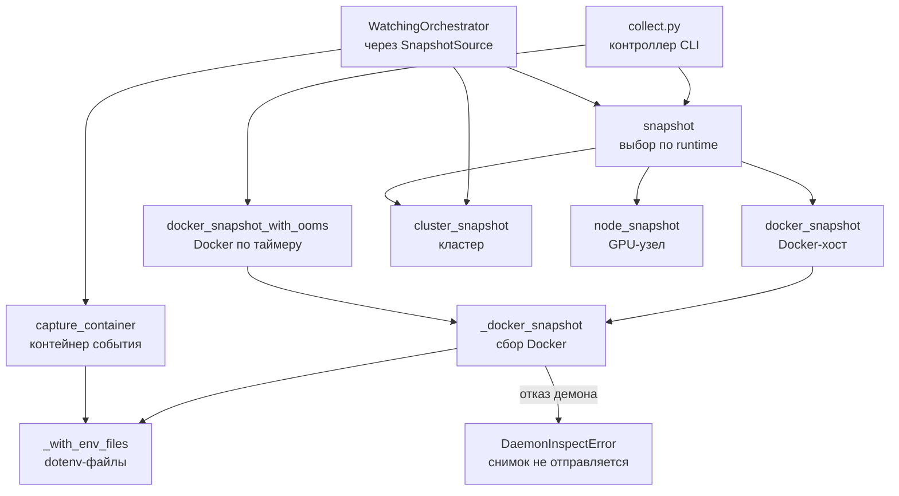
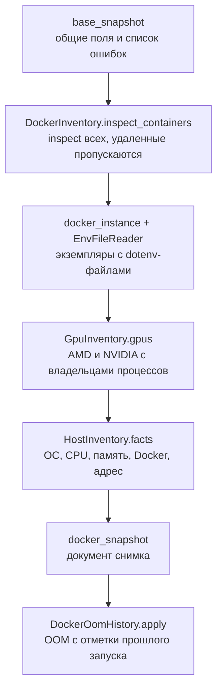
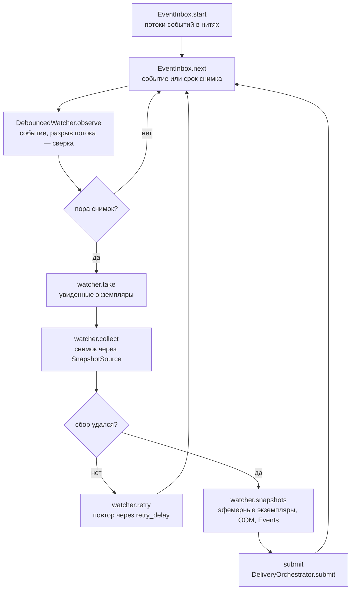
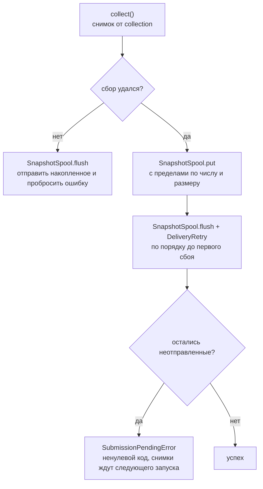
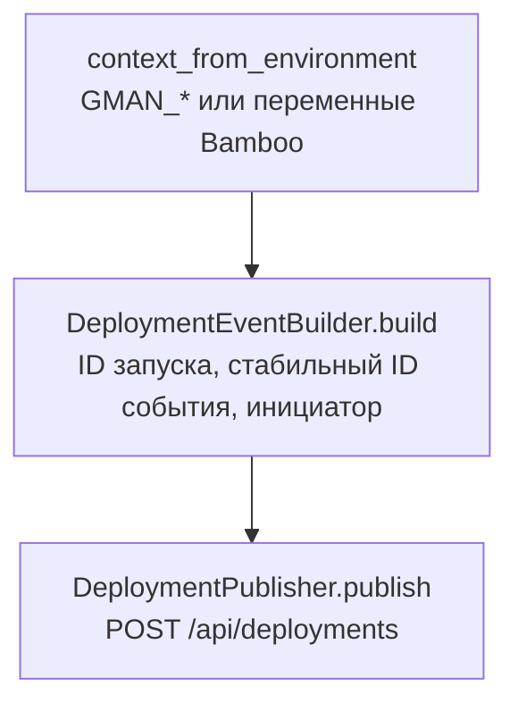

# Оркестраторы агента — схема функций

Источник: `src/<модуль>/orchestrator.py` четырех доменных модулей. Входящие порты: `src/collect.py` (CLI)
и `src/bamboo_event.py` (Bamboo).

## CollectionOrchestrator

Источник: `src/collection/orchestrator.py`.

### Карта методов

| Метод | Видимость | Назначение |
| --- | --- | --- |
| snapshot | public | Снимок настроенного runtime (Docker, кластер, GPU-узел) |
| docker_snapshot | public | Снимок Docker-хоста: контейнеры с dotenv-файлами, GPU, хост |
| docker_snapshot_with_ooms | public | Снимок Docker по таймеру плюс OOM-kill из событий демона |
| cluster_snapshot | public | Снимок кластера; --watch передает pod-ы из кеша |
| node_snapshot | public | Снимок GPU-узла с процессами, отнесенными к pod-ам |
| capture_container | public | Состояние контейнера на момент события (для --watch) |
| pod_instances / pod_ref / pod_refs | public | Разбор pod-а для --watch |
| map_events / relevant_event | public | Сопоставление и фильтр Events Kubernetes |
| _docker_snapshot | private | Снимок Docker с общим списком ошибок |
| _with_env_files | private | Экземпляр из inspect с dotenv-файлами |

### Граф вызовов



### `docker_snapshot_with_ooms` — последовательность шагов



### Внешние зависимости

```text
docker_snapshot / docker_snapshot_with_ooms / capture_container
  ├─ mappers: base_snapshot, docker_snapshot, docker_instance, env_file_location, attach_env_files, event_instance,
  │           instances_of
  └─ services: DockerInventory, EnvFileReader, GpuInventory, HostInventory, DockerOomHistory
cluster_snapshot / node_snapshot
  ├─ mappers: cluster_snapshot, node_snapshot, kube_events, pod_ref, pod_index
  └─ services: KubernetesInventory, GpuInventory, PodAttribution
```

## WatchingOrchestrator

Источник: `src/watching/orchestrator.py`.

| Метод | Видимость | Назначение |
| --- | --- | --- |
| watch | public | Цикл: события, debounce, сбор и отправка снимков |
| _snapshot | private | Сбор и отправка снимков одного цикла; неудача — повтор позже |



```text
watch
  ├─ services: DockerWatcher или KubeWatcher (DebouncedWatcher, with_ephemeral), EventInbox
  ├─ adapters (через EventInbox): DockerEventFeed, KubernetesWatchFeed
  └─ ports: SnapshotSource (оркестратор collection)
```

## DeliveryOrchestrator

Источник: `src/delivery/orchestrator.py`.

| Метод | Видимость | Назначение |
| --- | --- | --- |
| acquire_lock | public | Блокировка источника на время процесса |
| run_once | public | Запуск по таймеру: собрать, положить в spool, отправить накопленное |
| submit | public | Положить снимки в spool и отправить накопленное (--watch) |



```text
acquire_lock / run_once / submit
  └─ services: RunGuard, SnapshotSpool, DeliveryRetry
```

## DeploymentReportOrchestrator

Источник: `src/deployment_report/orchestrator.py`.

| Метод | Видимость | Назначение |
| --- | --- | --- |
| event | public | Событие деплоя по окружению шага Bamboo |
| send | public | Построить и отправить событие |



```text
event / send
  ├─ mappers: context_from_environment
  └─ services: DeploymentEventBuilder, DeploymentPublisher
```
