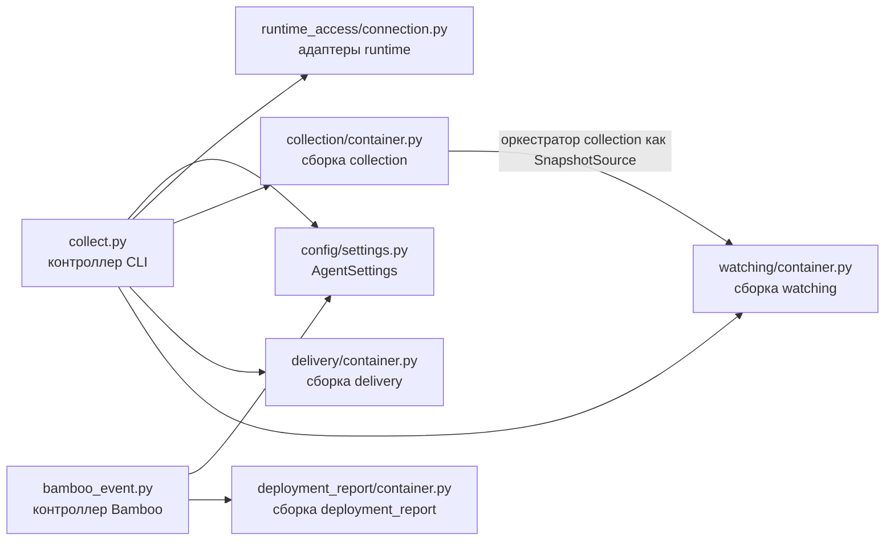
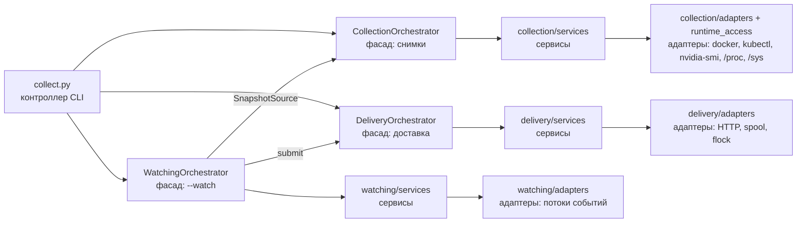
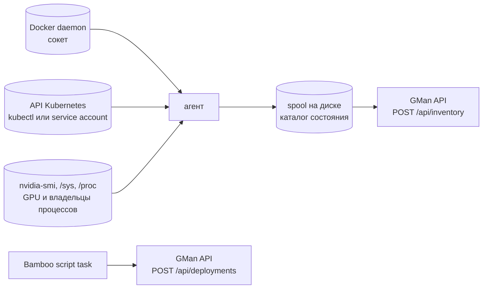

# agent — схема структуры сервиса

Источник: корень `agent/` (см. также `README.md` в корне репозитория, раздел об агенте).

Агент inventory GMan (только чтение) собирает снимки Docker-хоста, кластера Kubernetes или GPU-узла
кластера и отправляет их в GMan API; второй входящий порт отправляет событие деплоя из Bamboo.
Во время выполнения агенту нужен только python3: на хосты он ставится одним файлом `gman-agent.pyz`,
поэтому сторонних зависимостей нет, а настройки читает `config/settings.py` (stdlib-dataclass вместо
pydantic-settings). Poetry управляет только инструментами тестов.

## Дерево репозитория

```text
agent/
├── Dockerfile                  # образ агента хоста GMan (Docker CLI + src), запуск collect.py
├── env_example                 # переменные окружения
├── pyproject.toml              # Poetry: зависимостей времени выполнения нет, dev — pytest, pydantic
├── poetry.lock
├── docs/
│   ├── service_structure.md    # этот файл
│   └── orchestrator_flow.md    # схемы функций оркестраторов
├── scripts/
│   ├── build_pyz.py            # сборка gman-agent.pyz (zipapp)
│   ├── build.sh                # pyz и образ
│   ├── run.sh                  # запуск из репозитория
│   └── test.sh                 # тесты через Poetry
├── tests/
│   ├── conftest.py             # поддельный запуск команд, сборка модулей, HTTP-модели API для контракта
│   └── test_*.py
└── src/
    ├── collect.py              # контроллер CLI: печать снимка, запуск по таймеру или --watch
    ├── bamboo_event.py         # контроллер Bamboo: событие деплоя
    ├── config/
    │   ├── settings.py         # AgentSettings из окружения
    │   └── logging.py          # логи в stderr (stdout занят JSON)
    ├── runtime_access/         # общий адаптер доступа к runtime для collection и watching
    │   ├── command_runner.py   # запуск команд без stderr
    │   ├── docker_cli.py       # docker ps/inspect/cp/events/version; ContainerEvent
    │   ├── kubernetes_api.py   # kubectl или API изнутри кластера; KubernetesGoneError
    │   └── connection.py       # RuntimeAccess: один набор адаптеров на процесс
    ├── collection/             # домен: снимки
    │   ├── container.py        # цель сбора и сборка зависимостей
    │   ├── orchestrator.py     # фасад: снимки Docker, кластера, GPU-узла; разбор объектов для watch
    │   ├── entity.py           # документы экземпляра/GPU, владельцы процессов, ссылки на pod-ы, время
    │   ├── mappers/            # inspect, pod, узел, Events -> документы; сборка снимка
    │   ├── services/           # inventory Docker, dotenv-файлы, GPU, атрибуция, OOM, Kubernetes, хост
    │   └── adapters/           # nvidia-smi, sysfs AMD, cgroup, сведения о хосте, отметка OOM
    ├── watching/               # домен: --watch (снимки по событиям с debounce)
    │   ├── container.py        # сборка для Docker или Kubernetes
    │   ├── orchestrator.py     # фасад: цикл событий и снимков
    │   ├── entity.py           # тайминги, элементы watch, документ снимка
    │   ├── ports.py            # протокол SnapshotSource (реализует оркестратор collection)
    │   ├── services/           # debounce, watcher Docker и Kubernetes, эфемерные снимки, очередь
    │   └── adapters/           # поток docker events, протокол list+watch Kubernetes
    ├── delivery/               # домен: доставка в API
    │   ├── container.py        # адрес API, spool и блокировка в каталоге состояния
    │   ├── orchestrator.py     # фасад: блокировка, запуск по таймеру, отправка через spool
    │   ├── entity.py           # исходы доставки, лимиты, снимок в spool
    │   ├── services/           # spool, повторы с backoff, блокировка запуска
    │   └── adapters/           # HTTP API, каталог spool, flock
    └── deployment_report/      # домен: событие деплоя Bamboo
        ├── container.py · orchestrator.py · entity.py · mappers.py
        ├── services/           # построение события, публикация
        └── adapters/           # HTTP API приема деплоев
```

Снимок — JSON-документ для API: поля, добавленные в API, проходят без изменений агента. Поэтому экземпляр,
GPU и снимок — документы, обернутые сущностями с доступом к полям, которые использует логика агента.
Мапперы строят документы из сырых данных runtime; адаптеры читают внешние форматы (CSV nvidia-smi, sysfs,
cgroup, JSON событий) в сущности.

## Граф компонентов

### 1. Сборка зависимостей



### 2. Runtime



## Поток данных runtime



## Запрещённые зависимости

- `orchestrator → container`, `orchestrator → adapters` (блокировка и HTTP — через сервисы `RunGuard`,
  `DeploymentPublisher`).
- `services → mappers`, `services → orchestrator` своего модуля.
- `adapters → services`, `adapters → mappers`.
- `entity → services/adapters/mappers`; `config → orchestrator/services/adapters`.
- Между модулями — через оркестратор: watching получает снимки и разбор объектов runtime только через
  протокол `watching/ports.py:SnapshotSource` (его реализует оркестратор collection) и использует типы этого
  контракта (`collection.entity`: документ экземпляра, ссылка на pod, время RFC 3339). Общий адаптер
  `runtime_access/` используют адаптеры collection и watching.
