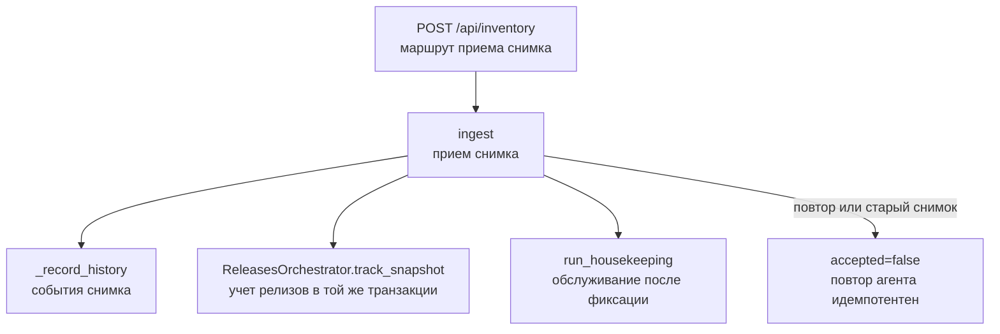
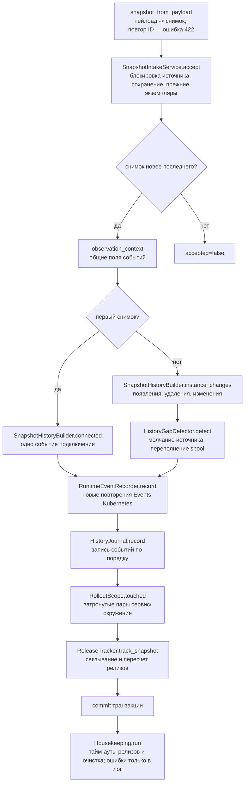
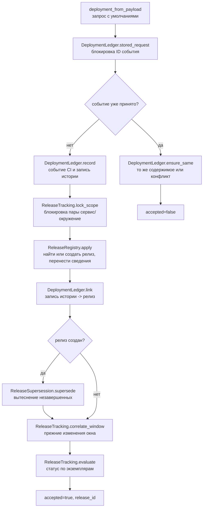
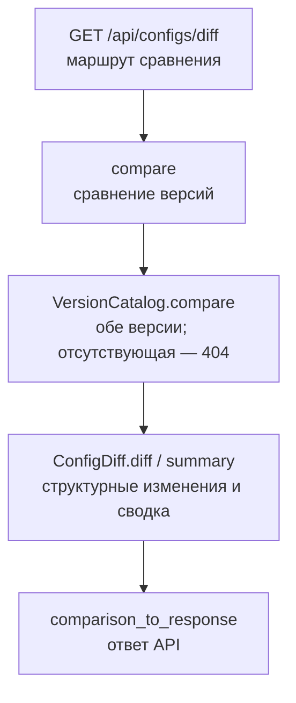
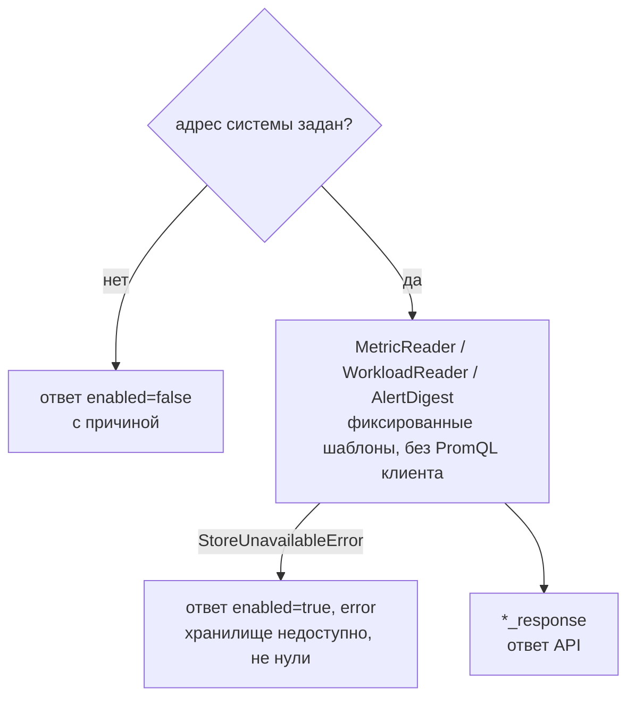
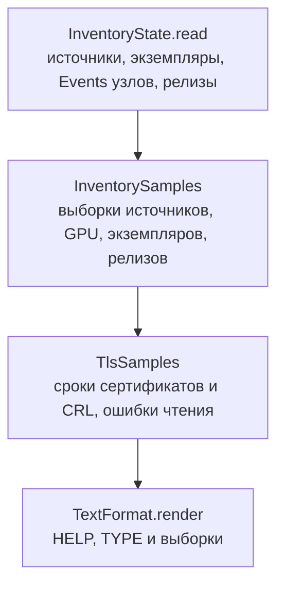

# Оркестраторы GMan API — схема функций

Источник: `src/<модуль>/orchestrator.py` пяти доменных модулей. Каждый оркестратор — единственная точка входа
своего модуля; маршруты `src/api/routes` вызывают только их. Сценарии с БД выполняются в одной транзакции
(`database/unit_of_work.py`); вложенный сценарий другого модуля присоединяется к открытой транзакции.

## InventoryOrchestrator

Источник: `src/inventory/orchestrator.py`.

### Карта методов

| Метод | Видимость | Назначение |
| --- | --- | --- |
| ingest | public | Принять снимок источника и записать изменения в историю |
| run_housekeeping | public | Тайм-ауты релизов и очистка истории старше срока (не чаще интервала) |
| register_service | public | Создать или обновить сервис каталога с записью изменения |
| overview | public | Каталог, источники с экземплярами и сводкой Events узлов, последние события |
| history | public | Страница аудита (новые первыми) |
| splunk_links | public | Ссылки на поиск Splunk для сервиса и его экземпляров |
| _record_history | private | Записать события снимка: подключение или изменения, разрывы, Events |

### Граф вызовов



### `ingest` — последовательность шагов



### Внешние зависимости

```text
ingest
  ├─ mappers: snapshot_from_payload, observation_context, ingest_response
  ├─ services: SnapshotIntakeService, SnapshotHistoryBuilder, HistoryGapDetector, RuntimeEventRecorder,
  │            HistoryJournal, RolloutScope, Housekeeping
  └─ ports: ReleaseTracker (оркестратор releases)
register_service
  ├─ mappers: catalog_service_from_payload, splunk_override_from_service, catalog_service_to_response
  └─ services: SplunkLinkBuilder.check_override, ServiceCatalog.register
overview / history / splunk_links
  ├─ mappers: overview_to_response, history_page_to_response, log_targets_from_sources, splunk_links_to_response
  └─ services: ServiceCatalog, SourceOverview, HistoryJournal, SplunkLinkBuilder
```

## ReleasesOrchestrator

Источник: `src/releases/orchestrator.py`.

### Карта методов

| Метод | Видимость | Назначение |
| --- | --- | --- |
| record_deployment | public | Принять событие деплоя Bamboo, создать или обновить релиз |
| track_snapshot | public | После снимка: связать его события с релизами и пересчитать статусы |
| expire | public | Завершить по тайм-ауту релизы, раскатка которых не сошлась |
| releases | public | Страница релизов |
| release | public | Релиз со связанными событиями и экземплярами раскатки |

### Граф вызовов



```mermaid
flowchart TB
  deploy_route["POST /api/deployments<br/>маршрут события CI"]
  inventory["InventoryOrchestrator<br/>прием снимка и обслуживание"]
  record["record_deployment<br/>событие деплоя"]
  track["track_snapshot<br/>учет по снимку"]
  expire["expire<br/>тайм-ауты"]
  deploy_route --> record
  inventory --> track
  inventory --> expire
  record -- "тот же ID, другое содержимое" --> conflict["DeploymentConflictError<br/>409"]
  record -- "повтор" --> duplicate["accepted=false"]
```

### `record_deployment` — последовательность шагов



### Внешние зависимости

```text
record_deployment
  ├─ mappers: deployment_from_payload, deployment_response
  └─ services: DeploymentLedger, ReleaseTracking, ReleaseRegistry, ReleaseSupersession
track_snapshot / expire
  └─ services: ReleaseTracking (EventCorrelator, ReleaseEvaluator, ImageMatcher, InstanceHealth)
releases / release
  ├─ mappers: release_filter_from_params, page_to_response, detail_to_response
  └─ services: ReleaseReader
```

## ConfigHistoryOrchestrator

Источник: `src/config_history/orchestrator.py`.

| Метод | Видимость | Назначение |
| --- | --- | --- |
| service_versions | public | Версии конфигураций всех экземпляров сервиса без тел |
| instance_versions | public | Версии конфигураций одного экземпляра |
| version | public | Одна версия с телом конфигурации |
| compare | public | Изменения от одной версии к другой |



```text
service_versions / instance_versions / version / compare
  ├─ mappers: page_to_response, version_to_response, comparison_to_response
  └─ services: VersionCatalog (ConfigDiff)
```

## TelemetryOrchestrator

Источник: `src/telemetry/orchestrator.py`.

| Метод | Видимость | Назначение |
| --- | --- | --- |
| current_metrics | public | Последние значения метрик всех объектов |
| metric_range | public | Ряд метрики одного объекта за период |
| workloads | public | Workloads Kubernetes сервиса или кластера |
| active_alerts | public | Сработавшие алерты без заглушенных и подавленных |



```text
current_metrics / metric_range / workloads / active_alerts
  ├─ mappers: range_query_from_params, workload_matchers_from_params, *_response
  └─ services: MetricReader, WorkloadReader (WorkloadClassifier), AlertDigest
```

## ExpositionOrchestrator

Источник: `src/exposition/orchestrator.py`.

| Метод | Видимость | Назначение |
| --- | --- | --- |
| render | public | Все метрики inventory и сроков TLS в текстовом формате Prometheus |



```text
render
  └─ services: InventoryState, InventorySamples, TlsSamples (TlsWatch, TlsParser), TextFormat
```
