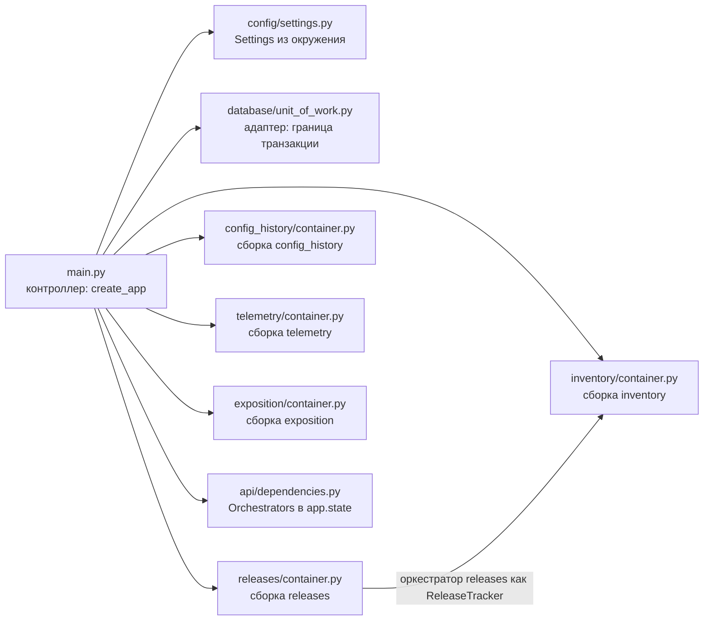
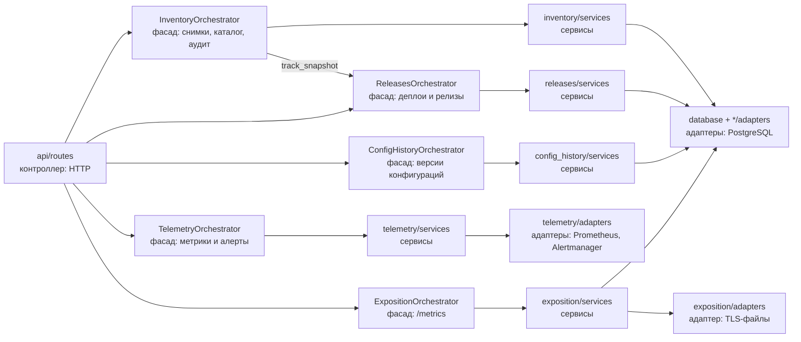
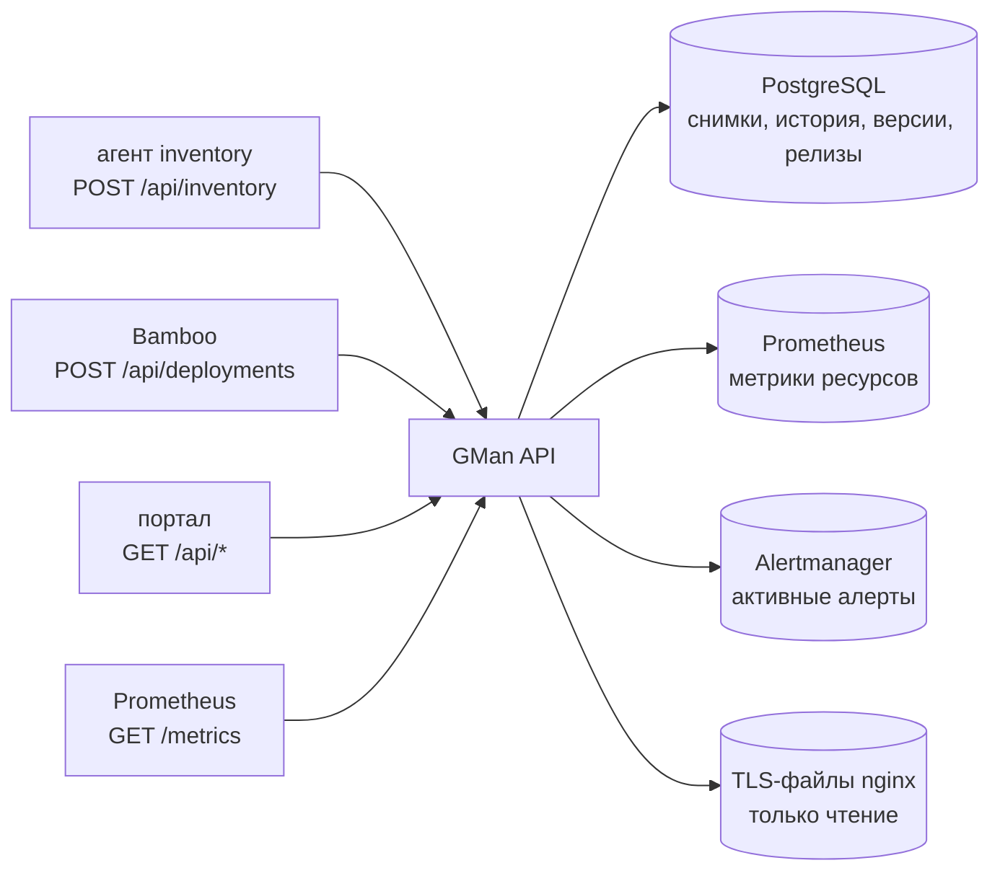

# backend — схема структуры сервиса

Источник: корень `backend/` (см. также `README.md` в корне репозитория).

GMan API принимает снимки inventory от агентов и события деплоя от Bamboo, хранит каталог, историю изменений,
версии конфигураций и релизы, отдает порталу метрики Prometheus и алерты Alertmanager, а Prometheus — метрики
состояния inventory для правил алертов.

## Дерево репозитория

```text
backend/
├── Dockerfile                  # образ: окружение Poetry в сборочном слое, uvicorn main:create_app --factory
├── env_example                 # переменные окружения (pydantic-settings)
├── pyproject.toml              # зависимости (Poetry) и настройки pytest
├── poetry.lock
├── alembic.ini                 # CLI alembic: миграции из каталога migrations/
├── migrations/                 # схема БД; API применяет их при старте (lifespan)
├── docs/
│   ├── service_structure.md    # этот файл
│   └── orchestrator_flow.md    # схемы функций оркестраторов
├── scripts/
│   ├── build.sh                # сборка образа
│   ├── run.sh                  # локальный запуск с перезагрузкой
│   └── test.sh                 # тесты через Poetry
├── tests/
│   ├── conftest.py             # БД на тест, клиенты приложения с настройками и подменой HTTP
│   └── test_*.py
└── src/
    ├── main.py                 # контроллер: create_app — контейнеры модулей, оркестраторы, маршруты
    ├── lifespan.py             # старт: миграции; остановка: пул соединений
    ├── config/
    │   ├── settings.py         # Settings (pydantic-settings) из переменных окружения
    │   └── logging.py          # настройка логирования
    ├── api/                    # HTTP-граница: маршруты, коды ответа, HTTP-модели
    │   ├── dependencies.py     # оркестраторы из состояния приложения
    │   ├── errors.py           # 500 без подробностей
    │   ├── schemas/            # HTTP-модели запросов (самодостаточны: их проверяет и тест контракта агента)
    │   └── routes/             # inventory, configs, releases, telemetry, system (/healthz, /metrics)
    ├── database/               # общий адаптер хранилища для всех модулей
    │   ├── tables.py           # ORM-записи (сверяются с миграциями `alembic check`)
    │   ├── engine.py           # engine и применение миграций под блокировкой
    │   ├── unit_of_work.py     # транзакция сценария, общая для репозиториев; StorageError
    │   ├── advisory_lock.py    # advisory-блокировки PostgreSQL по ключу
    │   ├── keyset_cursor.py    # курсоры страниц
    │   └── column_types.py     # UTC-время, JSON/JSONB, ID
    ├── inventory/              # домен: прием снимков, каталог, аудит, обзор, ссылки Splunk
    │   ├── container.py        # сборка зависимостей, разбор настроек Splunk
    │   ├── orchestrator.py     # фасад модуля
    │   ├── entity.py           # сервис каталога, экземпляр, снимок, событие истории, ссылки на логи
    │   ├── mappers.py          # пейлоады API -> DTO, DTO -> ответы
    │   ├── ports.py            # протокол учета релизов (реализует releases)
    │   ├── services/           # прием снимка, история, разрывы, Events, каталог, обслуживание, Splunk
    │   └── adapters/           # репозитории источников, экземпляров, событий, отметок, каталога, очистка
    ├── config_history/         # домен: версии конфигураций и их сравнение
    │   ├── container.py · orchestrator.py · entity.py · mappers.py
    │   ├── services/           # каталог версий, структурное сравнение
    │   └── adapters/           # репозиторий версий
    ├── releases/               # домен: деплои Bamboo и статус релизов по наблюдениям runtime
    │   ├── container.py · orchestrator.py · entity.py · mappers.py
    │   ├── services/           # журнал CI, реестр, вытеснение, учет, оценка, связывание, чтение
    │   └── adapters/           # репозитории релизов, событий, экземпляров, событий CI
    ├── telemetry/              # домен: метрики ресурсов, workloads, активные алерты
    │   ├── container.py · orchestrator.py · entity.py · mappers.py
    │   ├── services/           # шаблоны PromQL, чтение метрик и workloads, классификация, дайджест алертов
    │   └── adapters/           # клиенты Prometheus и Alertmanager
    └── exposition/             # домен: /metrics для правил алертов
        ├── container.py · orchestrator.py · entity.py
        ├── services/           # выборки inventory и TLS, текстовый формат, наблюдение за TLS-файлами
        └── adapters/           # чтение состояния inventory, чтение TLS-файлов
```

Сущности модулей — dataclass без зависимостей от внешних форматов. Снимок и экземпляр приходят от агента
JSON-документом, который хранится и сравнивается целиком (поля, добавленные в API, проходят без миграции),
поэтому их сущности оборачивают документ и дают типизированный доступ к полям бизнес-логики. Адаптеры
переводят внешние форматы (строки БД, ответы Prometheus и Alertmanager, файлы) в сущности; мапперы переводят
входящие пейлоады API в DTO и DTO в ответы.

## Граф компонентов

### 1. Сборка зависимостей



### 2. Runtime



## Поток данных runtime



## Запрещённые зависимости

- `orchestrator → container`, `orchestrator → adapters` (транзакцию оркестратор получает как функцию
  `transaction`, данные — только через сервисы), `orchestrator → api`.
- `services → mappers`, `services → orchestrator` своего модуля, `services → api`.
- `adapters → services`, `adapters → mappers`, `adapters → orchestrator`.
- `entity → services/adapters/mappers`; `config → orchestrator/services/adapters`.
- Между модулями — только через оркестратор: inventory зависит от releases через протокол
  `inventory/ports.py:ReleaseTracker` (примитивы и время), а не через сервисы или адаптеры releases.
  Общий адаптер хранилища `database/` используют адаптеры всех модулей.
- `api/` обращается к доменам только через оркестраторы (и импортирует типы ошибок из entity для кодов ответа).
