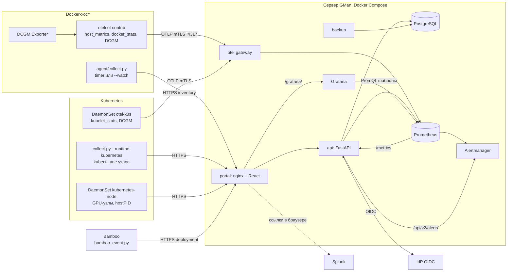

# Архитектура GMan

Статус: описание фактической реализации первой версии на 11 октября 2026 года.
Пилот не подключен к производственным серверам: что проверено только на эмуляторах
и тестах — в [next-steps.md](next-steps.md) («Не проверено»); инструкции по запуску — в README.
Там, где реализация отличается от исходного проекта, отклонение отмечено «Отличие от проекта».

## Подтвержденные требования

- Шесть серверов; отдельные Docker-хосты плюс Kubernetes-кластер.
- Часть сервисов запускается через Bamboo, часть — вручную на серверах.
  Оба способа запуска должны поддерживаться независимо друг от друга.
- CI/CD — Bamboo. Репозитории — Bitbucket/GitLab.
- GPU на серверах — NVIDIA. Для локальных проверок доступна AMD.
- Первая версия: каталог, мониторинг и аудит. Управление workloads откладывается.
- Интерфейс объединяет сведения о сервисе и ссылки на специализированные приложения.
- OpenTelemetry принимает и маршрутизирует телеметрию.

Прикладной стек: FastAPI, PostgreSQL, React/TypeScript. Не выяснены: состав узлов
Kubernetes, число workloads, модели GPU, действующие Grafana/хранилище метрик, индексы
и поля Splunk, IdP для SSO, канал уведомлений, сроки хранения и требования доступности.

## Компоненты



| Компонент | Реализация | Назначение |
| --- | --- | --- |
| Inventory agent | agent/collect.py, Python stdlib | Снимок Docker-хоста, кластера или GPU-узла; spool, retry, flock, `--watch` |
| Bamboo hook | agent/bamboo_event.py | Событие деплоя из deployment job |
| API | backend/app (FastAPI, SQLAlchemy, Alembic) | Прием inventory и деплоев, каталог, история, конфигурации, вход, чтение метрик и алертов |
| Портал | frontend (React/TypeScript, Vite), nginx | Каталог, карточки, серверы и GPU, алерты, аудит |
| Хранилище каталога | PostgreSQL 17 | Каталог, текущее состояние, история, сессии |
| Телеметрия | otelcol-contrib 0.162.0 на узлах и gateway | Метрики хостов, контейнеров, kubelet, DCGM |
| Метрики | Prometheus 3.5.0, хранение 30 дней | Временные ряды, правила алертов |
| Алерты | Alertmanager 0.28.1 | Группировка, подавление, webhook/email |
| Визуализация | Grafana 12.1.1 | Дашборды «Хост», «Сервис», «Kubernetes» |
| Логи | существующий Splunk | Только ссылки на поиск; GMan логи не читает |

## Потоки данных

Каталог/inventory и телеметрия — независимые каналы. Конфигурации и релизы не кодируются
как метрики, временные ряды не хранятся в таблицах каталога. Связь — общие идентификаторы
(source_id = host_id, ID контейнера, UID pod-а, UUID GPU; см. «Идентификация»).

### Inventory

1. Агент на Docker-хосте читает `docker ps -aq` и `docker inspect` (allowlist полей),
   nvidia-smi или AMD sysfs, сведения о хосте. Агент кластера читает pods, nodes и pod Events
   через kubectl (или API с service account). Агент GPU-узла (`kubernetes-node`) читает nvidia-smi,
   `/proc/<pid>/cgroup` и pods своего узла.
2. Снимок пишется в spool на диске и отправляется `POST /api/inventory` с Bearer-токеном
   источника. Повторы с backoff; неотправленное остается в spool.
3. API сопоставляет токен с source_id до разбора тела, проверяет схему (extra=forbid),
   берет advisory lock источника и отвергает дубликат или снимок не новее принятого
   (`accepted=false`).
4. Снимок заменяет текущее состояние источника (sources, instances); новая конфигурация
   экземпляра создает строку config_snapshots. Разница с прошлым снимком записывается
   событиями (см. «Кем и когда запущено»); новые повторения Kubernetes Events — событиями
   runtime-event; молчание источника дольше GMAN_HISTORY_GAP_SECONDS (300 с) или отброшенные
   агентом снимки — событием history-gap.
5. Портал получает `GET /api/overview` (каталог, источники с экземплярами, последние 200
   событий) раз в 30 секунд.

Сбор — периодический опрос (systemd timer раз в минуту) либо режим `--watch`: `docker events`
или watch API Kubernetes. Снимок через 2 с тишины, не позже 10 с от первого события и не реже
60 с; контейнер или pod, исчезнувший до снимка, отправляется промежуточным снимком. После
разрыва потока событий — полная сверка. Пропущенные во время разрыва короткие события не
восстанавливаются.

Kubernetes `--watch` (KubeWatcher в agent/collect.py): два потока — pods и pod Events. Каждый
делает list (`kubectl get --raw`, чтобы сохранить resourceVersion списка; без kubectl — API с
service account) и watch от этой версии с allowWatchBookmarks и timeoutSeconds; по истечении
watch продолжается с последней версии (BOOKMARK ее сдвигает). 410 Gone — версия удалена
compaction: немедленный повторный list. Прочие сбои — маркер сверки и повторный list с
экспоненциальным backoff до 60 с. Снимок строится из кэша pod-ов, узлы читаются при каждом
снимке. Удаленные pod-ы помнятся 10 минут, чтобы сопоставить их поздние Events.

Kubernetes Events (allowlist): только involvedObject.kind = Pod, pod с меткой gman.service,
reason из списка OOMKilling, BackOff, FailedScheduling, Unhealthy, Killing, Failed, Evicted,
FailedMount, FailedCreatePodSandBox, Preempting. Поля: uid, reason, type, count (с учетом
series), first/last time, namespace/pod/контейнер (из fieldPath) → instance_id, компонент.
message не передается — в нем бывают вывод проб, адреса registry и ошибки команд; вместо него
detail из фиксированных фраз (вид пробы, причины FailedScheduling, ресурс Evicted, ошибка
образа). API проверяет тот же allowlist и записывает событие один раз на новое повторение:
runtime_event_marks хранит последний count и время по (source_id, uid).

Docker OOM: restart policy сбрасывает State.OOMKilled, а OOM kill дочернего процесса не
останавливает контейнер. Watcher запоминает время события `oom` и проставляет его в
last_oom_at экземпляра в каждом снимке, пока контейнер существует. API сохраняет последнее
известное last_oom_at (поле не сбрасывается пропуском), пишет событие instance-oom и отдает
gman_instance_last_oom_timestamp_seconds; GManInstanceOOMKilled срабатывает 30 минут после
OOM kill. В Kubernetes last_oom_at берется из termination state (current и lastState).

Отличие от проекта: доступ к Docker — через Docker CLI с группой docker, а не через
ограничивающий proxy. Без `--watch` Kubernetes опрашивается целиком раз в минуту.

### Телеметрия

1. Docker-хост: otelcol-contrib как host process (systemd) — host_metrics, docker_stats
   (метки gman.service/gman.environment переносятся в метрики), scrape DCGM Exporter
   127.0.0.1:9400. Атрибут host.id = GMAN_HOST_ID.
2. Kubernetes: DaemonSet deploy/otel-k8s.yaml — host_metrics узла, kubelet_stats,
   k8s_attributes, DCGM на узле; host.id = имя узла, k8s.cluster.name = source_id кластера.
   kube-state-metrics (deploy/kube-state-metrics.yaml, v2.20.0, list/watch только pods,
   nodes, deployments, statefulsets, daemonsets, replicasets, jobs; allowlist метрик)
   забирает Collector узла его pod-а, отдельным pipeline без host.id и k8s_attributes, с
   метками source_id и k8s_cluster_name кластера.
3. Узловые Collector отправляют OTLP gRPC в gateway (в production — mTLS, порт 4317).
4. Gateway (memory_limiter, batch) отдает метрики через prometheus exporter
   (resource_to_telemetry_conversion; ряды молчащих источников удаляются через 90 с).
   Prometheus читает его каждые 30 с.
5. API читает Prometheus фиксированными шаблонами PromQL (`/api/metrics/current`,
   `/api/metrics/range`); произвольный PromQL от клиента не принимается. Grafana читает
   тот же Prometheus.

Логи приложений не собираются: портал строит ссылки на поиск в Splunk
(`GET /api/logs/splunk`, шаблон SPL с экранированием значений). Трейсы не включены.

Отличие от проекта: отдельного экземпляра Collector для метрик кластера нет —
kube-state-metrics читает Collector DaemonSet-а на узле его pod-а. Состояние экземпляров
(причины, рестарты) по-прежнему берется из inventory, состояние workloads (реплики,
rollout, Pending, Job) — из kube-state-metrics.

### Алерты

```
OTel gateway ──┐
               ├─► Prometheus (rules.yaml, recording rules) ─► Alertmanager ─► webhook / email
API /metrics ──┘                                                   │
 (inventory: источники, узлы,                                      └─► GET /api/alerts ─► портал «Алерты»
  экземпляры, GPU из nvidia-smi)
```

Через OTel gateway приходят и метрики хостов и DCGM, и kube-state-metrics кластеров.

API отдает на `/metrics` состояние inventory (backend/app/exposition.py): время последнего
снимка источника, число ошибок сбора, Ready узлов, рестарты и причины состояния экземпляров
(только из фиксированного списка), температуру/ECC/причины троттлинга GPU из nvidia-smi
(не старше 5 минут). Путь не проксируется nginx и читается Prometheus внутри сети Compose.
Recording rules объединяют DCGM и nvidia-smi (DCGM важнее), выбирают порог перегрева по
модели GPU (таблица gman-gpu-thresholds, по умолчанию 85/90 °C) и связывают pod-ы
kube-state-metrics с workload (Deployment через ReplicaSet) и сервисом (метки gman.* pod-ов).
24 алерта: узел, источник, телеметрия, gateway и kube-state-metrics молчат, узел Kubernetes
NotReady, GPU XID/ECC/перегрев/троттлинг, OOMKilled (включая время последнего OOM kill), CrashLoopBackOff, частые перезапуски,
образ не скачивается, недоступные реплики, застрявший rollout, Pending, упавшая Job,
DaemonSet не на своих узлах. Inhibition: упавший узел скрывает алерты своих GPU и
контейнеров, молчащий источник — алерты своих экземпляров, NotReady узла — недоступные
pod-ы DaemonSet-ов кластера, Pending/rollout — warning о репликах того же workload.
Runbook — страница портала `#alerts/<имя>`. Silence — в UI Alertmanager.

### Вход и доступ

1. Портал запрашивает `GET /api/auth/info`. При настроенном OIDC браузер уходит на
   `/api/auth/login`: API создает state, nonce и PKCE verifier в подписанной cookie (10 минут)
   и перенаправляет в IdP.
2. `/api/auth/callback`: обмен кода (конфиденциальный клиент), проверка ID token по JWKS
   (только асимметричные алгоритмы, issuer, audience/azp, nonce, срок), группы из claim или
   userinfo, роль по GMAN_OIDC_*_GROUPS. Без подходящей группы вход отклоняется.
3. Сессия хранится в таблице sessions (хеш значения cookie, роль, CSRF-токен, срок, по
   умолчанию 8 часов). Браузер держит только HttpOnly cookie (`__Host-` и Secure при HTTPS,
   SameSite=Lax). Изменяющие запросы требуют X-CSRF-Token.
4. Явный заголовок Authorization имеет приоритет над cookie: Bearer GMAN_READ_TOKEN (чтение)
   и GMAN_ADMIN_TOKEN (администратор) — для автоматизации и режима без SSO.

Машинные учетные данные отдельны: токен на каждый source_id (GMAN_AGENT_TOKENS),
GMAN_CI_TOKEN для Bamboo. OTLP — клиентские сертификаты пилотного CA.

### Bamboo

Script task `agent/bamboo_event.py` в deployment job отправляет `POST /api/deployments`
(started/succeeded/failed): build, release, environment, commit, image digest, инициатор,
build URL, а также deployment_id (deploymentResultId), version и image для сверки.
Значения по умолчанию берутся из документированных переменных `bamboo_*` (см. README).
event_id детерминирован, повтор с тем же payload не создает второе событие, с другим — 409.
Сбой отправки не валит деплой (кроме GMAN_REQUIRED=true).

Событие создает или обновляет релиз, статус которого выводится из runtime-сверки
(раздел «Релизы: сверка Bamboo и runtime»).

Обнаружение сервисов основано на фактическом состоянии Docker/Kubernetes. Bamboo —
дополнительный источник сведений о деплое, а не условие включения сервиса в мониторинг.
Отсутствие события Bamboo не доказывает ручной запуск. Контейнер без меток и записи
в каталоге виден как непривязанный экземпляр.

## Модель данных

PostgreSQL, схема из Alembic-миграций (0001 — нормализованная схема, 0002 — имя и окружение
экземпляра в config_snapshots, 0003 — sessions, 0004 — releases и events.release_id, 0005 — runtime_event_marks). Миграции применяются при старте API под
advisory lock. Снимки, экземпляры и конфигурации хранятся как проверенный JSON (JSONB);
колонками вынесено только то, по чему фильтруют и сортируют, поэтому новые поля схемы API
не требуют миграций. Время хранится в UTC (timestamptz).

| Таблица | Ключ | Содержание |
| --- | --- | --- |
| services | id | Каталог: name, description, owner, team, repository, ссылки grafana/splunk/bamboo; extra (JSON): owners, logs.splunk и будущие поля |
| sources | source_id | Последний принятый снимок источника без экземпляров: тип, hostname, observed_at, received_at, сведения о хосте, GPU, узлы Kubernetes, ошибки сбора |
| instances | source_id + instance_id | Текущие экземпляры источника: service_id, environment, runtime, status, хеш и ссылка на текущую конфигурацию, полный JSON экземпляра |
| config_snapshots | id | Различающиеся конфигурации экземпляра по хешу: service_id, instance_name, environment, config, first_seen_at/last_seen_at |
| events | id | Журнал: тип, service/source/instance, received_at, occurred_at, release_id, JSON события с actor и changes |
| deployments | event_id | Исходный запрос CI для идемпотентности |
| releases | id | Прогон деплоя Bamboo для сервиса/окружения: версия, image/digest, commit, инициатор, статус и причина, окно, прогресс экземпляров |
| sessions | sha256 cookie | SSO-сессии: subject, роль, email/имя/группы на момент входа, CSRF-токен, срок |
| runtime_event_marks | source_id + uid | Последний записанный count и время Kubernetes Event — дедупликация повторов; удаляется по GMAN_RETENTION_DAYS |

Соответствие сущностям исходного проекта:

| Сущность проекта | Реализация |
| --- | --- |
| Service | services |
| Environment | Строка gman.environment у экземпляра; отдельной сущности и ограничений доступа по окружению нет |
| Workload | Не нормализован: поле controller (Compose project/service или Kind/имя контроллера Kubernetes) |
| Instance | instances; история — events и config_snapshots |
| Host | sources (docker-host) с ОС, ядром, CPU, Docker, uptime; узлы Kubernetes — список nodes в снимке кластера |
| GPU | Список gpus в снимке источника (UUID, PCI, модель, драйвер, показатели, процессы); MIG — только режим |
| ConfigSnapshot | config_snapshots |
| Deployment | releases (статус из сверки с runtime) + deployments + событие deployment |
| AuditEvent | events |

Один сервис может иметь несколько реплик на нескольких узлах и разные версии при rollout:
экземпляры хранятся отдельно, имя контейнера не является ID сервиса, пересоздание
контейнера/pod-а не создает новый сервис.

## Идентификация

| Объект | Идентификатор |
| --- | --- |
| Сервис | services.id; привязка экземпляра — label gman.service (Docker) или label Pod (spec.template.metadata.labels) |
| Окружение | label gman.environment, иначе `unknown` |
| Источник Docker | source_id = `--source-id` агента = GMAN_HOST_ID Collector = host_id в метриках |
| Источник кластера | source_id = `--source-id` агента = k8s.cluster.name в метриках |
| Источник GPU-узла | `<кластер>.<узел>` (API требует source_id = cluster + "." + hostname), source_type kubernetes-node, поле cluster; экземпляров не содержит; host_id в /metrics = имя узла |
| Экземпляр Docker | полный ID контейнера; в метриках container_id |
| Экземпляр Kubernetes | `<pod uid>:<имя контейнера>`; в метриках k8s_pod_uid + k8s_container_name, init containers включены |
| Узел Kubernetes | имя узла = host_id в метриках узла |
| GPU | UUID NVIDIA (метка UUID в DCGM); у AMD — путь устройства |
| Процесс GPU | PID узла → cgroup → ID контейнера → экземпляр; в Kubernetes дополнительно namespace, pod, instance_id |

Источник GPU-узла нужен потому, что агент кластера работает через kubectl и не видит PID узлов.
Pod-ы по-прежнему сообщает источник кластера, поэтому история не дублируется; портал показывает
GPU узла в карточке кластера. Загрузку GPU по pod-ам дают метки namespace/pod/container DCGM
Exporter в режиме Kubernetes (значения всей карты; при time-slicing/MPS — общие).

Неизвестные workloads показываются в разделе «Не привязаны к каталогу»; произвольные имена
автоматически не объединяются. В метрики попадают host.id, ID контейнера/pod-а, UUID GPU,
gman_service/gman_environment, k8s.namespace/pod; command, env, пользователь, commit и build URL
в метки не попадают.

## Кем и когда запущено

Раздельно хранятся и показываются:

- Владелец сервиса (`owner`, «Ответственный») — описание, не доказательство запуска.
- Владельцы записи (`owners`) — кто может менять запись каталога (роль owner).
- Инициатор деплоя — actor и actor_kind (human/service-account/schedule/unknown) из события
  Bamboo с пометкой источника «Bamboo integration assertion»; не подтверждается запросом к Bamboo.
- Пользователь процесса — user из конфигурации контейнера (UID/имя), не автор.
- Время: created_at, started_at, finished_at из runtime; observed_at снимка (occurred_at
  события) и received_at сервера. Время обнаружения не подменяет время запуска.

Типы событий журнала:

| Тип | Источник | actor |
| --- | --- | --- |
| source-connected | первый снимок источника, одно событие с числом экземпляров | unknown, runtime observation |
| instance-appeared / instance-removed | разница снимков | unknown |
| config-changed / instance-restarted / state-changed | разница снимков, changes «было/стало» | unknown |
| instance-oom | новое last_oom_at экземпляра (Docker `oom` или OOMKilled, Kubernetes termination) | unknown |
| runtime-event | новое повторение Kubernetes Event pod-а: reason, event_type, count, occurrences, detail | unknown, Kubernetes Event |
| history-gap | источник молчал дольше GMAN_HISTORY_GAP_SECONDS или агент отбросил снимки (spool overflow): gap_from/gap_to, reasons, dropped_snapshots; по событию на каждый затронутый сервис | unknown |
| deployment | Bamboo | из CI, actor_source = Bamboo integration assertion; release_id |
| instance-appeared / config-changed, связанные с релизом | разница снимков + сверка с релизом | инициатор релиза, actor_source = Bamboo, correlated by digest/version |
| service-created / service-updated | изменение каталога через API | email/логин SSO (human) или GMAN_ADMIN_TOKEN (unknown), с ролью и subject |

Первый снимок не считается деплоем. Происхождение (compose project/service/working dir,
OCI source/revision/version, app.kubernetes.io/*, helm chart, Kubernetes field managers)
сохраняется как подсказка о способе запуска, а не как автор.

Docker events не дают надежного человека-инициатора; для Kubernetes нужен audit log control
plane, а не Events. Ни то, ни другое не реализовано: автор runtime-изменения — «неизвестно»,
кроме изменений, сопоставленных с релизом Bamboo (см. ниже); в портале несопоставленные
появления и изменения конфигурации показываются как «ручной запуск / инициатор неизвестен».

### Релизы: сверка Bamboo и runtime

Реализовано в backend/app/releases.py, таблица `releases` (миграция 0004_releases),
ссылка `events.release_id`. Релиз — один прогон deployment Bamboo для пары
сервис/окружение: версия и релиз Bamboo, image ref и digest, commit, сборка,
инициатор из Bamboo, время начала, статус и причина, прогресс экземпляров.
Прогон определяется `deployment_id` (deploymentResultId из bamboo_resultsUrl);
без него — `build_id|release`, и новый started после завершенного прогона того же
build/release считается повторным деплоем.

Статусы (выводятся, а не утверждаются CI):

- started — Bamboo сообщил о начале, ни один экземпляр не запущен с целевым образом;
- rolling-out — хотя бы один экземпляр сервиса/окружения на целевой версии;
- succeeded — все экземпляры целевого image repository в окружении на целевой версии
  и здоровы (running, health пусто/healthy, ready не false, без reason) либо
  завершились с exit 0; кроме того, хотя бы один из них создан в окне релиза или
  Bamboo сообщил succeeded (иначе повторный деплой той же версии «успешен» мгновенно);
- failed — Bamboo сообщил failed (перекрывает даже succeeded), новый экземпляр
  в окне релиза перезапускался GMAN_RELEASE_CRASH_RESTARTS (3) раза, CrashLoopBackOff
  или OOMKilled, либо раскатка не сошлась за GMAN_RELEASE_TIMEOUT_MINUTES (30);
- superseded — до завершения начат более новый релиз той же пары. Поздно пришедшее
  событие более старого деплоя сразу получает superseded.

Сопоставление экземпляра с релизом: сначала image digest (sha256 в image или image_id),
затем версия — тег образа, org.opencontainers.image.version или
app.kubernetes.io/version против version/release/тега image из Bamboo; тег latest
не используется. Если runtime знает manifest digest (Kubernetes imageID, образ
по @sha256) и он другой, совпадение тега не засчитывается. На Docker image_id —
это ID образа (config digest), а не manifest digest из registry: для сверки по digest
передавайте из Bamboo `docker image inspect --format '{{.Id}}'` или запускайте образ
по digest; иначе работает сверка по версии. Sidecar-контейнеры с другим репозиторием
образа в прогресс не входят.

Окно релиза: от начала минус GMAN_RELEASE_LEAD_MINUTES (10; расхождение часов и
runtime раньше события Bamboo) до завершения или тайм-аута. Если первым пришло
финальное событие, окно начинается за тайм-аут до него. Runtime-события окна
связываются с релизом: появление экземпляра и изменение конфигурации на целевой
версии получают инициатора релиза с actor_source «Bamboo, correlated by digest|version»;
удаление прежней версии, перезапуски и изменения состояния связываются без смены
автора. События вне окна или без совпадения остаются «ручной запуск / инициатор
неизвестен». Связь с более новым релизом не перезаписывает уже связанные события.

Пересчет: в транзакции приема снимка (для затронутых пар) и события Bamboo, под
advisory lock `release:<service>|<env>` на PostgreSQL; тайм-ауты — в существующем
шаге housekeeping после снимков (не чаще раза в минуту, без отдельного демона),
поэтому при молчащих агентах тайм-аут наступит со следующим снимком любого
источника. Повторы снимков и событий отбрасываются раньше, повторный пересчет
неизменных данных ничего не меняет. Завершенные релизы старше retention удаляются.

### Ручные запуски

Человек запускает контейнер привычным способом; агент обнаруживает его при следующем опросе
или сразу по `docker events` в режиме `--watch`, получает конфигурацию и время старта.
Перевод в Bamboo, CI build ID и ссылка Bamboo не требуются; репозиторий, команда и ссылки
задаются в каталоге независимо от способа запуска.

Для атрибуции ручных запусков нужен отдельный механизм (не реализован):

- Аутентифицированный CLI/посредник запуска, фиксирующий пользователя и результат
  Docker/Kubernetes API. Имя из переменной окружения или `--actor` само по себе личность не
  подтверждает. Прямой запуск в обход посредника остается видимым без автора.
- Аудит действий на сервере с персональными учетными записями и корреляцией с
  runtime-событиями; для Kubernetes — аудит API. SSH-сессия или общий root-аккаунт не
  доказывают авторство конкретного контейнера.

## Портал

Экраны: «Сервисы» (каталог с поиском, непривязанные экземпляры), «Серверы и GPU»
(карточки Docker-хостов и кластеров с узлами, GPU и процессами), «Алерты» (активные алерты
и runbook), «Аудит» (постраничный журнал). Над экранами — сводка: сервисы, источники
(устаревшие и с ошибками сбора), видеокарты, непривязанные экземпляры; фильтр окружения.
Обновление раз в 30 секунд; источник, последний снимок которого принят сервером (received_at)
более 3 минут назад по часам сервера, помечается «Данные устарели».

Карточка сервиса: название, описание, кнопки Репозиторий, Grafana (по умолчанию дашборд
«GMan · Сервис» с service_id), «Логи в Splunk», Bamboo. Незаданная ссылка показывается как
«не настроен», подставные адреса не используются. Вкладки:

1. Обзор: команда, ответственный, владельцы записи, ID, репозиторий; редактор записи каталога
   для owner/admin; текущее размещение.
2. Ресурсы: CPU в ядрах и память против лимитов, GPU по pod-ам, графики за 1 час / 24 часа /
   7 дней; ссылки в Grafana и Splunk за тот же период.
3. Экземпляры: размещение, состояние отдельно от health/ready, причина и прошлое завершение,
   CPU/память, VRAM процессов, рестарты, время создания и старта, ссылка на логи экземпляра.
4. Конфигурация: текущая конфигурация каждого экземпляра, процессы GPU, происхождение;
   история версий с фильтром по экземпляру и diff «Было/Стало».
5. Релизы: деплои Bamboo со статусом из runtime-сверки, инициатор, версия, прогресс,
   длительность; карточка релиза с экземплярами и связанными событиями.
6. История: события сервиса; у связанных с релизом — ссылка «Релиз #N».

CPU контейнера — в ядрах (1.0 = одно ядро), процент — от лимита контейнера. VRAM — память
процессов контейнера, не доля загрузки GPU. Нет метрик — «—» и предупреждение, а не ноль.

Отличие от проекта: отдельных экранов «состояние интеграций» и списка «последние деплои»
нет (деплои — во вкладке «Релизы» и в истории); открытые проблемы сервиса на карточке не показываются
(только на странице «Алерты»). Ссылки в Grafana передают сервис (хост, кластер), окружение фильтра
портала и период вкладки «Ресурсы» (var-*, from/to).

## Метрики

| Область | Источник | Что собирается |
| --- | --- | --- |
| CPU хоста | host_metrics | utilization по состояниям (в т. ч. iowait, steal), load, частоты |
| RAM хоста | host_metrics | usage/utilization по состояниям, swap (paging) |
| Диски и ФС | host_metrics | емкость и utilization ФС, bytes/operations диска |
| Сеть хоста | host_metrics | bytes/packets, errors/drops по интерфейсам |
| Контейнеры Docker | docker_stats | CPU, throttling, память, сеть, block I/O, pids, uptime, рестарты |
| Контейнеры Kubernetes | kubelet_stats | CPU, working set, сеть pod-а, доля от limits/requests |
| Состояние экземпляров | inventory | status, health, ready, причина, exit code, рестарты, прошлое завершение |
| Узлы Kubernetes | inventory | Ready, pressure, cordon, taints, capacity/allocatable, сумма requests CPU/RAM/GPU |
| GPU NVIDIA | DCGM Exporter (deploy/dcgm-counters.csv) | загрузка, copy util, VRAM, температуры и slowdown, мощность, энергия, частоты, XID, ECC SBE/DBE, переназначение строк, причины снижения частот, PCIe replay |
| Workloads Kubernetes | kube-state-metrics | желаемые/доступные реплики, generation, Progressing, фаза и владелец pod-ов, Unschedulable, Failed у Job, misscheduled DaemonSet, Ready узлов |
| GPU NVIDIA | nvidia-smi (inventory) | модель, PCI, драйвер, pstate, загрузка, VRAM, температуры, мощность/лимит, частоты, вентилятор, throttle reasons, ECC, PCIe, MIG, persistence, процессы с VRAM |
| GPU AMD | sysfs (inventory) | busy, VRAM, датчики edge/junction/mem, частоты, вентилятор (локальная проверка) |
| Pipeline | Prometheus, /metrics | up gateway и API, время последнего снимка и ошибки сбора источников |

Неподдерживаемый показатель передается как отсутствующий, а не ноль; температуры датчиков
не объединяются. GPU host-метрики не приписываются целиком контейнеру: связь процесса с
контейнером/pod-ом дает VRAM процесса, загрузка по pod-ам — только для карт, выделенных
через device plugin.

Не собираются: PSI, OOM-события хоста (вне контейнеров) как метрика, SMART/NVMe, hwmon хоста,
BMC/IPMI/Redfish, NVLink-счетчики, retired pages, SM/tensor profiling, метрики MIG-инстансов,
прочие объекты kube-state-metrics (Services, PVC, HPA, CronJob, ResourceQuota).

## Сбор, хранение и надежность

| Параметр | Значение |
| --- | --- |
| Метрики узлов | раз в 15 с (Collector), Prometheus читает gateway раз в 30 с |
| Inventory | раз в минуту (timer, случайная задержка до 15 с) или по событиям `--watch` |
| Устаревание | от received_at (часы сервера): портал — 3 минуты; алерт GManSourceSilent — 5 минут |
| Метрики | Prometheus, 30 дней; ряды молчащих источников удаляются из gateway через 90 с |
| События и конфигурации | GMAN_RETENTION_DAYS (180, 0 — отключить); текущие конфигурации не удаляются; деплои хранятся без срока |
| SSO-сессии | истекшие удаляются ежечасной очисткой и при входе, независимо от GMAN_RETENTION_DAYS |
| Бэкап | pg_dump раз в сутки, проверка `pg_restore --list`, ротация 14 файлов |

Агент: spool на диске (100 файлов / 50 MiB, при переполнении удаляются старые с отметкой
в errors нового снимка), повторы с экспоненциальным backoff и jitter на сеть/таймаут/5xx/429,
401/403 — без повторов с сохранением снимков, 422 — снимок удаляется. Неблокирующий flock на
источник. При ошибке полного сбора снимок не отправляется, чтобы не пометить все экземпляры
удаленными; частичные ошибки (например, nvidia-smi) передаются в errors и видны в портале.
Сервер принимает снимки идемпотентно и не затирает новый старым; события получают время
observed_at, а не время доставки.

Collector: memory_limiter, batch, in-memory sending_queue и retry_on_failure.
Пробел в истории отмечается явно: если между принятыми снимками источника прошло больше
GMAN_HISTORY_GAP_SECONDS (300 с — пять интервалов агента, как GManSourceSilent) или снимок
сообщает «agent spool overflow», API пишет history-gap для каждого сервиса с экземплярами на
источнике до и после пробела (и без сервиса — для неразмеченных); портал показывает «Данные
за период могут быть неполными», в журнале аудита копии одного пробела сворачиваются.
Снимки, отправленные из spool после восстановления связи, пробела не образуют.

Отличие от проекта: постоянная очередь Collector на диске (file_storage) не настроена.
Самонаблюдение pipeline ограничено up{job} gateway и API
и метриками источников; lag, dropped и размер очередей Collector не собираются.
Внешнего мониторинга самого сервера GMan нет.

Предварительный бюджет для измерений, не гарантия: узловой Collector 0.25–0.5 CPU и
256–512 MiB RAM (systemd MemoryMax=512M); центральный стенд — 4 vCPU и 8–16 GiB RAM.
Емкость Prometheus: samples/day = active_series × 86400 / interval_seconds. После 24–72 часов
пилота измерить накладные расходы, cardinality, прирост диска и задержку.

## Доступ и безопасность

| Кто | Как | Права |
| --- | --- | --- |
| Человек, SSO | OIDC Authorization Code + PKCE, серверная сессия | viewer — чтение; owner — правка записей каталога, где он в `owners` (кроме самого `owners`); admin — все, включая новые сервисы |
| Автоматизация | Bearer GMAN_READ_TOKEN / GMAN_ADMIN_TOKEN | чтение / администратор; автор в журнале — имя токена |
| Агент inventory | Bearer-токен на source_id | только `POST /api/inventory` своего source_id |
| GPU-агент DaemonSet | bound service account token (audience `gman`), проверка TokenReview кластера (GMAN_K8S_TOKEN_REVIEW) | только снимок kubernetes-node своего узла (узел из привязки токена к pod-у) |
| Bamboo | Bearer GMAN_CI_TOKEN | только `POST /api/deployments` |
| Collector узла | клиентский сертификат пилотного CA (mTLS в nginx, CRL) | OTLP: host.id = CN сертификата хоста; для сертификата кластера k8s.cluster.name = CN |

Владение (`owners`) сопоставляется с subject, email, логином или `group:<группа>` без учета
регистра. Роль фиксируется при входе и действует до конца сессии. Изменения каталога
пишутся в журнал с автором и ролью.

Сеть (production): снаружи только 443 (портал, /api, Grafana на /grafana/), 80 (редирект)
и 4317 (OTLP gRPC с mTLS и CRL в nginx); Prometheus и Alertmanager — на 127.0.0.1, PostgreSQL и Grafana не
публикуются. nginx: TLS 1.2/1.3, HSTS, CSP, limit_req по IP, лимиты тела запроса.

Данные: агент отправляет allowlist полей inspect/Pod spec. Значения env (кроме
NVIDIA_VISIBLE_DEVICES/CUDA_VISIBLE_DEVICES), команды, args и команды проверок здоровья не
собираются и отвергаются схемой API; labels — только allowlist происхождения. Поэтому
конфигурации показываются без маскирования. Ссылки каталога — только HTTP(S) без учетных
данных; токены не помещаются в URL. Ошибки API не раскрывают параметры SQL и inventory.

Привилегии на узлах: агент и Collector Docker-хоста получают Docker socket через группу
docker (эквивалент root); systemd sandboxing ограничивает остальное. Kubernetes RBAC агента
кластера — get/list pods и nodes; DaemonSet GPU-узлов — list pods, hostPID, без capabilities.
Secrets и exec не используются, но доступ к Pod spec открывает env в API Kubernetes.

OTLP: mTLS завершает nginx (4317), потому что otelcol-contrib 0.162.0 не поддерживает CRL и не
отдает subject сертификата в конвейер. nginx проверяет CA и crl.pem и передает gateway
метаданные `x-gman-otlp-host`/`x-gman-otlp-cluster` из CN (`OU=client`/`OU=cluster`),
заменяя одноименные заголовки клиента; gateway (include_metadata, resource + filter до batch)
отбрасывает метрики с host.id ≠ CN и без метаданных, а k8s.cluster.name ставит из CN сертификата
кластера. Gateway не публикуется. Отзыв — `issue.sh revoke` + crl.pem + reload nginx.

GPU-агенты DaemonSet: projected token pod-а с audience `gman` вместо общих токенов; API
вызывает TokenReview кластера (сервисная учетная запись gman-token-reviewer с
system:auth-delegator) и берет узел из extra `authentication.kubernetes.io/node-name`
(Kubernetes ≥ 1.30) или из pod-а по имени и UID. Результат кэшируется до 60 с; недоступный
API кластера — 503 (агент повторит). Статические токены продолжают работать.

Бэкапы: хук выгрузки после каждого дампа (BACKUP_UPLOAD_CMD) и регулярная проверка
восстановления во временную базу с контрольными запросами; оба влияют на healthcheck.

Отличие от проекта: сертификат кластера общий для узлов DaemonSet, host.id узлов кластера им
не привязан; ограничивающий proxy для Docker socket не используется.

## Развертывание

Один сервер GMan, Docker Compose: deploy/compose.yaml (стенд, все порты на 127.0.0.1) и
override deploy/compose.prod.yaml (Compose ≥ 2.24.4).

```
                 443/80
 пользователи ─────────► portal (nginx) ─► api ─► db
 агенты, Bamboo ───────►   │ /grafana/        ▲   ▲
 узловые Collector ────►   │ OTLP + CN ───────┼───┼──────────► otel gateway
   4317 mTLS + CRL         │                  │   │               │
                           ▼                  │   │ backup        │
                        grafana ──► prometheus ◄──┴───────────────┘
                                     │   ▲ /metrics (api)
                                     ▼
                                alertmanager ─► webhook / SMTP
```

| Сервис Compose | Production |
| --- | --- |
| db (postgres:17-alpine) | не публикуется |
| api | за nginx; миграции при старте |
| portal (nginx) | 443/80, TLS из deploy/pki или корпоративного CA; 4317 — OTLP mTLS для узлов |
| otel (gateway) | не публикуется; OTLP приходит через nginx (4317, mTLS, CRL) с идентичностью из сертификата |
| prometheus, alertmanager | 127.0.0.1:9090/9093 |
| grafana | только через /grafana/ |
| backup | pg_dump в GMAN_BACKUP_DIR, выгрузка (GMAN_BACKUP_UPLOAD_CMD), еженедельная проверка восстановления |

Узлы: systemd-юниты gman-collect.service/.timer (агент) и gman-otelcol.service (Collector)
из deploy/systemd; Kubernetes — deploy/otel-k8s.yaml, deploy/gpu-attribution-k8s.yaml,
deploy/kubernetes-rbac.yaml. Сертификаты — deploy/pki/issue.sh (ключ CA на сервер не копируется).
Prometheus и Grafana не бэкапятся: дашборды и datasource описаны в репозитории.

## Этапы и приемка

| Этап | Состояние |
| --- | --- |
| 1. Стек, контракты inventory/deployment, каталог, идентификаторы, локальный стенд | Сделано |
| 2. Один Docker-host и один Kubernetes namespace: обнаружение, привязка, конфигурации, diff | Реализовано; на реальных Docker и Kubernetes не проверено |
| 3. NVIDIA-узел и метрики через OTel, сверка с источником | Реализовано; проверено на эмуляции DCGM/Docker API/kubelet, не на NVIDIA |
| 4. Bamboo: успешный/неудачный деплой, инициатор, commit, digest; ручной запуск без Bamboo и меток | Endpoint, скрипт и релизы со сверкой с runtime сделаны, проверены тестами и против локального API; настоящий Bamboo — нет |
| 5. Каталог, карточки, исторические графики, внешние ссылки | Сделано (Grafana, Splunk); браузерная проверка новых страниц не завершена |
| 6. Остальные серверы, SSO и роли, разрыв связи, повторная доставка, устаревание, рестарт агента, backup/restore | SSO и роли — против mock IdP; надежность агента — тестами; backup/restore — на PostgreSQL 17 вне контейнера; на реальной инфраструктуре не проверено |
| Алерты (вне исходного плана) | Правила проверены promtool, доставка и inhibition — локальными бинарными релизами; workloads — на kube-state-metrics v2.20.0 против локального kube-apiserver; на реальных DCGM/кластере/SMTP нет |

Приемка первой версии (ни один пункт пока не подтвержден на шести серверах): все
согласованные workloads видимы; реплики и версии не смешиваются; время хранится в UTC,
UI показывает часовой пояс; у каждого actor есть источник; секреты не попадают в каталог;
сервисная учетная запись и человек различаются; отсутствие данных не показывается как нулевое
потребление; CPU/RAM/GPU сверены с источниками; ссылки открывают нужный
service/environment/time range; накладные расходы измерены.

## Дальнейший PaaS

После наблюдения: декларативная желаемая конфигурация, асинхронные операции
deployment/rollback, policy/approvals, quotas, reconciliation, registry, секреты через
существующий secret manager. Inventory отражает observed state, будущий control plane хранит
desired state отдельно. Роли SSO и журнал изменений каталога — основа для approvals.
Read-only API первой версии не расширяется произвольным исполнением shell-команд.
Ближайшие задачи — в [next-steps.md](next-steps.md) («Дальше по плану»).

## Локальная аппаратная проверка

10 октября 2026 года прочитаны доступные поля /sys/class/drm без изменения
настроек железа. Обнаружены два AMD-устройства (vendor 0x1002). На обоих
доступны GPU busy, VRAM total/used и температура; на card1 дополнительно
edge/junction/memory sensors, power average и fan input. Это разовый probe,
не проверка долговременного сбора и не валидация NVIDIA/DCGM.

## Первичные источники

- OTel agent → gateway: https://opentelemetry.io/docs/collector/deploy/other/agent-to-gateway/
- Docker stats receiver: https://github.com/open-telemetry/opentelemetry-collector-contrib/tree/main/receiver/dockerstatsreceiver
- Host metrics receiver: https://github.com/open-telemetry/opentelemetry-collector-contrib/tree/main/receiver/hostmetricsreceiver
- Kubelet stats receiver: https://github.com/open-telemetry/opentelemetry-collector-contrib/tree/main/receiver/kubeletstatsreceiver
- NVIDIA DCGM Exporter: https://docs.nvidia.com/datacenter/cloud-native/gpu-telemetry/latest/dcgm-exporter.html
- NVIDIA profiling, ограничения оборудования: https://docs.nvidia.com/datacenter/dcgm/latest/learn/modules/profiling.html
- AMD metrics: https://instinct.docs.amd.com/projects/device-metrics-exporter/en/main/configuration/metricslist.html
- Prometheus alerting rules: https://prometheus.io/docs/prometheus/latest/configuration/alerting_rules/
- Alertmanager: https://prometheus.io/docs/alerting/latest/configuration/
- OpenID Connect Core: https://openid.net/specs/openid-connect-core-1_0.html

Версии компонентов зафиксированы в deploy (otelcol-contrib 0.162.0, Prometheus 3.5.0,
Alertmanager 0.28.1, Grafana 12.1.1, PostgreSQL 17). При обновлении проверяется поддержка
receiver/exporter/метрик для выбранных версий и конкретных устройств.
